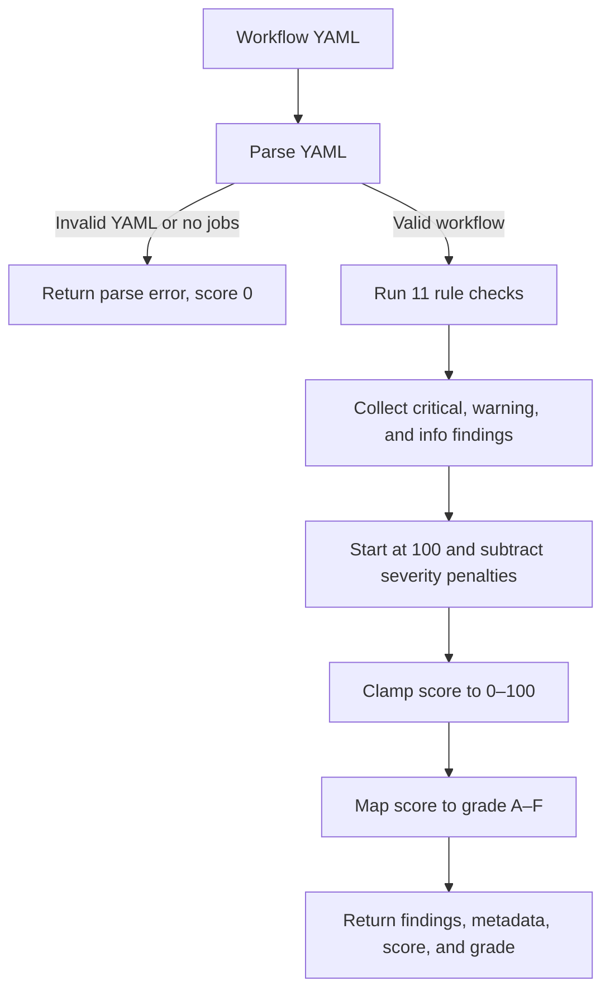

# CI/CD Guardian

CI/CD Guardian connects to a GitHub repository, inspects its workflows and run history, detects reliability and security issues, and combines heuristic risk scoring with AI-generated analysis.

## GitHub TLS trust

The server starts Node.js with `--use-system-ca`, so it trusts certificates installed in the operating system certificate store. This supports networks that inspect HTTPS traffic through an organization proxy without disabling TLS verification. If your proxy's root certificate is not installed in the system trust store, install the certificate provided by your IT administrator there, then restart the server with `npm run server` (or `npm run dev`). Do not use `NODE_TLS_REJECT_UNAUTHORIZED=0`; that disables certificate validation.

## How workflow analysis works

The backend statically inspects each GitHub Actions workflow. The heuristic analyzer is implemented in [`server/services/workflowAnalyzer.js`](server/services/workflowAnalyzer.js).



### Predefined heuristic rules

Each check looks for a particular YAML structure or text pattern. A rule creates a finding only when its condition is met.

| Rule | Category | Severity | What the analyzer checks |
| --- | --- | --- | --- |
| `no-permissions` | Security | Critical | Reports when neither workflow-level `permissions` nor any job-level `permissions` is present. |
| `no-timeout` | Reliability | Warning | Reports jobs without a truthy `timeout-minutes` value and lists their names. |
| `no-caching` | Performance | Warning | Looks for `npm install`, `pip install`, or `yarn` in the serialized workflow; reports it when neither `actions/cache` nor `setup-node` is found. |
| `hardcoded-version` | Maintainability | Warning | Finds action references matching `owner/action@v1` or `@v2` and reports those potentially old versions. |
| `no-env-protection` | Security | Warning | If the serialized workflow contains both `${{` and `secrets.`, checks jobs whose names contain `deploy` or `release`; reports a matching job without `environment`. |
| `no-concurrency` | Efficiency | Info | Reports when the workflow has no top-level `concurrency` setting. |
| `no-fail-fast` | Reliability | Info | Reports the first job with a matrix strategy that does not explicitly set `strategy.fail-fast`. |
| `inline-scripts` | Maintainability | Info | Counts `run` steps longer than 15 lines; reports the count. |
| `no-artifact-upload` | Observability | Info | If the serialized workflow contains `test`, `jest`, `pytest`, or `build`, reports when it lacks `actions/upload-artifact`. |
| `no-retry` | Reliability | Info | If it contains `npm install`, `pip install`, `docker pull`, `curl`, or `wget`, reports when neither `retry` nor `attempts` appears in the serialized workflow. |
| `no-path-filter` | Efficiency | Info | Reports when `push` has no `paths`/`paths-ignore` and `pull_request` also has no path filter. |

These are lightweight heuristics, not a full GitHub Actions validator: several rules search the serialized YAML text, and a failed individual rule is silently skipped. Findings include a message, a suggested improvement, and affected job names when available.

### Score and grade

The robustness score starts at **100**. The analyzer counts findings by severity, applies the penalties below, then clamps the result to the inclusive range **0–100**:

| Finding severity | Points deducted per finding |
| --- | ---: |
| Critical | 20 |
| Warning | 10 |
| Info | 3 |

`score = clamp(100 - (critical_count × 20) - (warning_count × 10) - (info_count × 3), 0, 100)`

| Final score | Grade |
| ---: | :---: |
| 90–100 | A |
| 75–89 | B |
| 60–74 | C |
| 40–59 | D |
| 0–39 | F |

For example, **1 critical + 2 warnings + 3 info findings** gives `100 - 20 - 20 - 9 = 51`, which maps to **D**. Invalid YAML or a parsed document with no `jobs` returns a parse error and score `0`; that error response does not include a grade.

For a valid workflow, the response also includes metadata: job count and names, detected trigger names, and total step count. The optional AI analysis is an additional layer; this rule-based score and its grades are computed in the workflow analyzer.

## Free AI setup

AI requests use Groq's free hosted inference when `GROQ_API_KEY` is set. If Groq is unavailable or no key is configured, the server tries Ollama at `OLLAMA_BASE_URL` using `OLLAMA_MODEL` (default `llama3.2`). For local inference, install Ollama and pull that model with `ollama pull llama3.2`. The server tries Groq first and falls back to Ollama automatically.

## Design system

The visual system lives in [`src/styles/tokens.css`](src/styles/tokens.css). It defines the aubergine ink surfaces, magenta/ultraviolet brand colors, apricot highlight, mint success, flare red danger, cyan info, typography, easing, and motion timing. `src/index.css` contains the component and responsive layer.

To retheme the product, change the tokens first:

- `--ink`, `--surface`, `--raised`, `--paper` control the surface hierarchy.
- `--primary`, `--secondary`, and `--highlight` control the poster gradients and active states.
- `--motion-factor` controls animation intensity.

Motion can be configured with `data-motion` on the root element:

```html
<html data-motion="full">      <!-- default -->
<html data-motion="reduced">   <!-- softer transitions -->
<html data-motion="off">       <!-- no movement -->
```

The app also respects `prefers-reduced-motion` automatically.

## Responsive checklist

- [x] 360px / 390px: single-column content, bottom navigation, safe-area padding, no page overflow.
- [x] 768px: compact icon navigation rail and stacked analysis panels.
- [x] 1024px: compact rail with multi-column content where space allows.
- [x] 1280px: full navigation rail and desktop bento layout.
- [x] 1536px / 1920px / 2560px: fluid type scale, constrained readable content, expanded panel heights.

Use `npm run build` to verify the production bundle.
